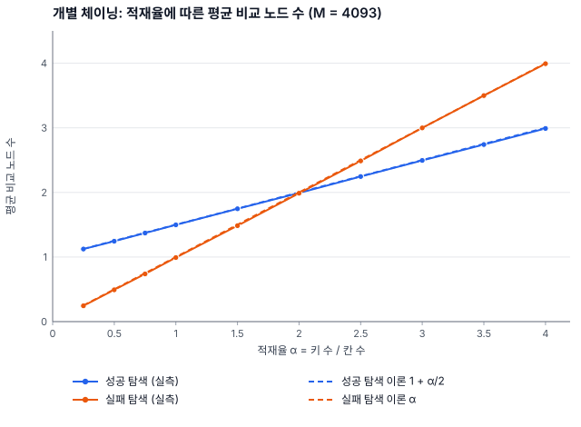
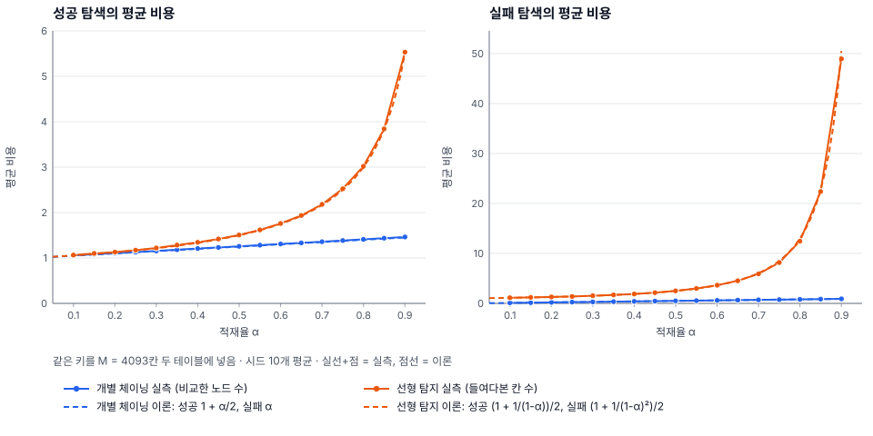

# 과제2 · 에이전트와 함께 만드는 URL 단축기

2026-2 **고급알고리즘**(SIT2001-01) 과제2 저장소입니다.
[hw2-starter-2026](https://github.com/lec-algorithm/hw2-starter-2026) 템플릿에서 시작해,
직접 만든 해시 테이블(개별 체이닝, 선형 탐지) 위에 URL 단축기를 올렸습니다.

- 과제 안내: [lec-algorithm.github.io/lecture/article/hw2-2026](https://lec-algorithm.github.io/lecture/article/hw2-2026/)
- 명세: [`SPEC.md`](SPEC.md) · 계획: [`PLAN.md`](PLAN.md) · 에이전트 규칙: [`.github/copilot-instructions.md`](.github/copilot-instructions.md)

## 돌려 보기

컨테이너 안(Codespaces 터미널)에서 실행합니다. Python 표준 모듈만 씁니다.

| 하고 싶은 것 | 명령 |
| --- | --- |
| 테스트 | `make test` |
| 웹 서버 (포트 8000, 개별 체이닝) | `make serve` |
| 웹 서버 (선형 탐지) | `make serve TABLE=probe` |
| 해시 테이블 화면 | 서버를 띄우고 `/table` |
| 6단계 체이닝 적재율 실험 | `make experiment` |
| 과제: 두 방식 비교 실험 | `make compare` |

## 파일

| 파일 | 하는 일 |
| --- | --- |
| `src/base62.py` | base62 `encode`/`decode` (0-9, a-z, A-Z) |
| `src/hash_table.py` | 개별 체이닝 `HashTable`, 호너 해시 `h ← (31·h + 글자 코드) mod M` |
| `src/probing_table.py` | 선형 탐지 `ProbingTable` (같은 인터페이스, 같은 해시) |
| `src/shortener.py` | `Shortener(table="chain" \| "probe")`: 일련번호 → base62 코드 |
| `src/server.py` | `http.server` 웹 서비스: 폼, 결과, 302 리디렉션, `/table` |
| `tests/` | `unittest` 테스트 (해시 테이블 공통 테스트를 두 방식에 모두 돌림) |
| `experiments/` | 적재율 실험과 비교 실험, CSV, SVG 그래프 |

## 6단계: 개별 체이닝의 탐색 비용

크기 4093인 테이블에 무작위 URL을 넣고 비교한 노드 수를 잰 결과입니다 (시드 5개 평균).
점선은 이론값(성공 약 1 + α/2, 실패 약 α)입니다. 수치는 [`experiments/results.csv`](experiments/results.csv).

## 과제: 개별 체이닝과 선형 탐지

같은 키를 같은 크기(M = 4093)의 두 테이블에 넣고 잰 결과입니다 (시드 10개 평균).
체이닝은 비교한 노드 수, 선형 탐지는 들여다본 칸 수입니다. 수치는 [`experiments/compare.csv`](experiments/compare.csv).

## 충돌 확인 방법 (/table)

서버를 새로 켠 뒤 아래 순서로 URL을 줄이고 `/table`을 열면 충돌이 보입니다 (칸 수 11 기준 호너 해시값).

| URL | 해시값 (mod 11) |
| --- | --- |
| https://www.naver.com | 6 |
| https://github.com | 6 |
| https://www.yonsei.ac.kr | 4 |
| https://ys.learnus.org | 4 |

- `make serve`: 4번, 6번 칸에 길이 2인 체인이 생깁니다.
- `make serve TABLE=probe`: ys.learnus.org는 5번, github.com은 7번 칸으로 밀려나 `h=4 · 2칸`, `h=6 · 2칸`으로 표시됩니다.
- URL을 누르면 `(31·h + 글자 코드) mod 11` 계산 과정이 글자마다 나옵니다.
